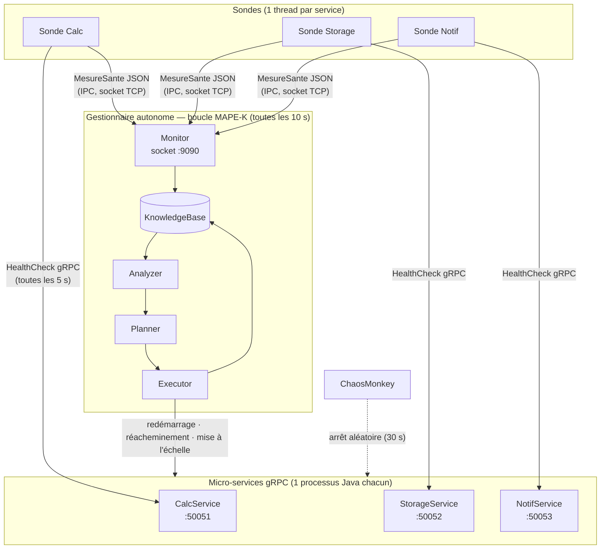

# AutonomicMesh

**Middleware distribué auto-géré avec gRPC, IPC et la boucle MAPE-K**

| | |
|---|---|
| **Équipe** | Minosoa Randrianatoandro / Zineb Haddar |
| **Cours** | IFT605 / IFT713 — Systèmes répartis et multi-agents |
| **Établissement** | Université de Sherbrooke — Automne 2026 |
| **Enseignante** | Amal Ben Abdellah |

---

## Présentation

Les infrastructures numériques modernes sont trop complexes pour être administrées à la main. L'**informatique autonome** (*Autonomic Computing*, IBM, 2001) répond à ce problème. Elle propose des systèmes capables de se configurer, de se réparer, de s'optimiser et de se protéger eux-mêmes, grâce à une boucle de contrôle appelée **MAPE-K** : *Monitor → Analyze → Plan → Execute*, autour d'une base de connaissances (*Knowledge*).

**AutonomicMesh** met ce principe en pratique. C'est un petit middleware distribué composé de trois micro-services Java qui communiquent en **gRPC**. Un **gestionnaire autonome** les surveille en permanence. Quand un service tombe en panne, ralentit ou est surchargé, le gestionnaire procède en quatre temps, sans intervention humaine :

1. il **détecte** le problème à partir des mesures envoyées par des sondes ;
2. il **diagnostique** le symptôme (panne totale, dégradation, surcharge) ;
3. il **décide** d'une action corrective (redémarrage, réacheminement, mise à l'échelle) ;
4. il **l'exécute** et vérifie le retour à la normale.

Un **ChaosMonkey** provoque volontairement des pannes, ce qui permet de mesurer l'efficacité de cette auto-guérison (MTTR, taux de détection, faux positifs, etc.).

## Architecture



### Rôle de chaque composant

| Composant | Rôle |
|---|---|
| **CalcService** | Effectue une opération arithmétique (`+ - * /`) et retourne le résultat avec sa latence. |
| **StorageService** | Stockage clé-valeur en mémoire (`Put` / `Get`, avec numéro de version). |
| **NotifService** | Reçoit un événement interne et confirme sa prise en charge. |
| **HealthCheck** | Exposé par chaque service. Il retourne le statut (`SERVING` / `DEGRADED` / `DOWN`), l'uptime et la charge CPU. |
| **AdminService** | Exposé par chaque service. Il injecte une latence ou une surcharge CPU simulée pour tester les dégradations. |
| **Sonde** | Appelle le HealthCheck toutes les 5 s, mesure la latence et envoie une `MesureSante` au Monitor. Si le service ne répond pas, elle produit une mesure `DOWN`. |
| **Monitor** (M) | Serveur socket sur le port 9090. Il reçoit les mesures JSON, les valide et met à jour la KnowledgeBase. |
| **KnowledgeBase** (K) | État partagé et thread-safe : dernières mesures, historique, compteur de pannes, table de routage. |
| **Analyzer** (A) | Détecte les symptômes : `PANNE_TOTALE` (DOWN), `DEGRADATION` (latence > 500 ms) et `SURCHARGE` (CPU > 0,90). |
| **Planner** (P) | Associe à chaque symptôme une action corrective, sans l'exécuter. |
| **Executor** (E) | Réalise les actions : relance du processus, modification du routage, démarrage d'une instance supplémentaire. |
| **GestionnaireAutonome** | Démarre le Monitor et lance le cycle Analyze → Plan → Execute toutes les 10 s. |
| **ChaosMonkey** | Arrête un service au hasard toutes les 30 s et journalise la panne, sa détection, l'action choisie et la récupération. |

### Politiques d'auto-guérison

| Symptôme | Condition | Action corrective |
|---|---|---|
| `PANNE_TOTALE` | statut `DOWN` | `REDEMARRER` : relance du processus gRPC (`ProcessBuilder`) |
| `DEGRADATION` | latence > 500 ms | `REACHEMINEMENT` : redirection du trafic dans la table de routage |
| `SURCHARGE` | charge CPU > 0,90 | `MISE_A_ECHELLE` : démarrage d'une instance supplémentaire |

## Technologies utilisées

| Technologie | Utilisation |
|---|---|
| **Java 21** | Langage du projet (records, `switch` expressions, *text blocks*) |
| **gRPC 1.66** | Appels de procédure à distance entre clients, sondes et services |
| **Protocol Buffers 3.25** | Contrat des services et des messages (`mesh.proto`) |
| **Sockets TCP (Java IPC)** | Canal de supervision entre les sondes et le Monitor |
| **Gson** | Sérialisation JSON des mesures de santé |
| **java.util.concurrent** | `ConcurrentHashMap`, `ScheduledExecutorService`, compteurs atomiques |
| **ProcessBuilder** | Lancement et relance des services comme processus indépendants |
| **Maven** (multi-module) | Compilation, génération du code Protobuf, JAR exécutables |
| **JUnit 5** | Tests unitaires et d'intégration |

La boucle MAPE-K est écrite en **Java pur**, sans aucun outil d'orchestration externe (ni Kubernetes, ni Docker Swarm).

## Structure du projet

```
AutonomicMesh/
├── pom.xml                         POM parent (versions, modules)
├── mesh-services/                  Micro-services, contrat gRPC et sondes
│   └── src/main/
│       ├── proto/mesh.proto        Contrat Protobuf
│       └── java/ca/usherbrooke/ift605/mesh/
│           ├── commun/             MesureSante, ServiceMesh (ports, commandes de lancement), Journal
│           ├── services/           CalcServer, StorageServer, NotifServer et leurs implémentations
│           ├── client/             ClientTest
│           └── sonde/              Sonde, LanceurSondes
├── mape-k/                         Gestionnaire autonome
│   └── src/main/java/ca/usherbrooke/ift605/mapek/
│                                   Monitor, KnowledgeBase, Analyzer, Planner, Executor, GestionnaireAutonome
├── chaos/                          ChaosMonkey et calcul des métriques
└── scripts/                        Démarrage / arrêt des services
```

## Installation et compilation

**Prérequis :** JDK 21 et Maven 3.9 ou plus récent.

```bash
git clone https://github.com/Min0soa/AutonomicMesh.git
cd AutonomicMesh
mvn clean package
```

La compilation régénère automatiquement les classes Java à partir de `mesh.proto`, lance les tests et produit deux JAR exécutables :

- `mesh-services/target/mesh-services-all.jar` contient les services, le client de test et les sondes ;
- `mape-k/target/mape-k-all.jar` contient tout ce qui précède, plus le gestionnaire autonome.

## Utilisation

### 1. Démarrer les trois micro-services

```bash
scripts/demarrer-services.sh          # Linux / macOS
scripts\demarrer-services.bat         # Windows
```

Chaque service tourne dans **son propre processus Java**. On peut aussi en lancer un seul à la main :

```bash
java -cp mesh-services/target/mesh-services-all.jar ca.usherbrooke.ift605.mesh.services.CalcServer 50051
```

### 2. Vérifier que les services répondent

```bash
java -cp mesh-services/target/mesh-services-all.jar ca.usherbrooke.ift605.mesh.client.ClientTest
```

```
=== Test des 3 micro-services AutonomicMesh sur localhost ===
[OK]    CalcService.Compute(6 * 7)          = 42.0  (traitement 0 ms)
        CalcService.HealthCheck                 statut=SERVING uptime=3s cpu=0.00
[OK]    StorageService.Put/Get("projet")    = "AutonomicMesh" (version 1, trouvé=true)
        StorageService.HealthCheck              statut=SERVING uptime=3s cpu=0.00
[OK]    NotifService.Notify(TEST_CLIENT)     accepté=true (total reçus 1)
        NotifService.HealthCheck                statut=SERVING uptime=3s cpu=0.00
=== Les 3 services ont répondu correctement ===
```

### 3. Lancer la supervision

Pour la **supervision seule** (Monitor et sondes, avec l'état de la KnowledgeBase affiché toutes les 5 s) :

```bash
java -cp mape-k/target/mape-k-all.jar ca.usherbrooke.ift605.mapek.MonitorMain --avec-sondes
```

Pour le **gestionnaire autonome complet** (boucle MAPE-K toutes les 10 s) :

```bash
java -cp mape-k/target/mape-k-all.jar ca.usherbrooke.ift605.mapek.GestionnaireAutonome
```

### 4. Provoquer des pannes

| Scénario | Commande |
|---|---|
| Panne totale | Arrêter le processus d'un service (`kill <PID>`, PID dans `logs/*.pid`) |
| Dégradation (latence) | `ClientTest degrader CalcService 800` |
| Surcharge (CPU) | `ClientTest degrader NotifService 0 0.95` |
| Retour à la normale | `ClientTest retablir CalcService` |
| Pannes aléatoires | lancer le **ChaosMonkey** du module `chaos` |

Dans le tableau, `ClientTest` désigne `java -cp mesh-services/target/mesh-services-all.jar ca.usherbrooke.ift605.mesh.client.ClientTest`.

Les journaux montrent alors la séquence complète : **Monitor → Analyze → Plan → Execute**, jusqu'au service rétabli.

## Interfaces communes

### Ports

| Composant | Port |
|---|---|
| CalcService | 50051 |
| StorageService | 50052 |
| NotifService | 50053 |
| Monitor (IPC) | 9090 |

### Format d'une mesure de santé

Chaque mesure est un objet JSON sur une seule ligne, envoyé par socket TCP :

```json
{"service":"CalcService","timestamp":1763250243512,"statut":"SERVING","latenceMs":3,"cpuLoad":0.04,"uptimeMs":125034}
```

| Champ | Description |
|---|---|
| `service` | Nom du service (ou de l'instance) |
| `timestamp` | Instant de la mesure (ms depuis l'époque Unix) |
| `statut` | `SERVING`, `DEGRADED` ou `DOWN` |
| `latenceMs` | Latence aller-retour du HealthCheck (ms) |
| `cpuLoad` | Charge CPU du processus, entre 0 et 1 |
| `uptimeMs` | Durée de fonctionnement du service (ms) |

### KnowledgeBase

| Méthode | Rôle |
|---|---|
| `getMesures()` | Dernière mesure de chaque service (copie immuable) |
| `majMesure(service, m)` | Enregistre une nouvelle mesure (appelée par le Monitor) |
| `getNbPannes(service)` / `incrementerPannes(service)` | Compteur de pannes atomique |
| `getRoute(service)` / `setRoute(service, cible)` | Table de routage utilisée pour le réacheminement |
| `getHistorique(service)` | Les 50 dernières mesures d'un service |

## Métriques évaluées

Le comportement du système est comparé **sans MAPE-K** (intervention manuelle simulée) et **avec MAPE-K** (récupération automatique) :

- **MTTR** (*Mean Time To Recovery*) : temps moyen entre la détection d'une panne et le rétablissement du service ;
- **Taux de détection** : pourcentage de pannes détectées en moins de 15 s ;
- **Faux positifs** : actions déclenchées à tort (par exemple un pic de latence passager) ;
- **Surcoût de la boucle MAPE-K** : consommation CPU et mémoire du gestionnaire autonome ;
- **Nombre de cycles MAPE-K** nécessaires avant la récupération complète.

Les résultats détaillés et leur analyse se trouvent dans le rapport du projet.

## Tests

```bash
mvn test
```

Les tests couvrent les points suivants :
- les opérations et le HealthCheck des trois services ;
- la production des statuts `SERVING`, `DEGRADED` et `DOWN` par la sonde ;
- l'envoi IPC, y compris quand le Monitor est absent ;
- la validation des mesures par le Monitor ;
- la sûreté de la KnowledgeBase en accès concurrent ;
- la chaîne complète sonde → Monitor → KnowledgeBase.

## Limites connues

- **Données non persistantes** : le StorageService garde ses données en mémoire, et elles sont perdues au redémarrage.
- **Délai de détection** : dans le pire cas, une panne est détectée après 5 s (période des sondes) plus 10 s (cycle MAPE-K), soit 15 s. C'est exactement le seuil du taux de détection.
- **Faux positifs possibles au démarrage** : au lancement d'une JVM, la compilation JIT peut faire dépasser 0,90 à la charge CPU pendant quelques secondes, ce qui peut déclencher une `SURCHARGE` à tort.
- **Environnement local uniquement** : tout le système, y compris le ChaosMonkey, fonctionne sur une seule machine.

---

*Projet réalisé dans le cadre du cours IFT605/IFT713 — Systèmes répartis et multi-agents, Université de Sherbrooke.*
